# 投顧研究報告全域知識圖譜 (Knowledge Map)

本文件以結構化矩陣與 Mermaid 視覺化圖表，呈現 15 份玉山投顧報告之市場板塊、產業族群、核心個股與投資觀點。

---

## 🗺️ 跨市場總體架構圖 (Mermaid Architecture)

```mermaid
graph TD
    classDef market fill:#1976D2,stroke:#0d47a1,stroke-width:2px,color:#fff;
    classDef report fill:#7B1FA2,stroke:#4a148c,stroke-width:2px,color:#fff;
    classDef industry fill:#388E3C,stroke:#1b5e20,stroke-width:2px,color:#fff;
    classDef stock fill:#F57C00,stroke:#e65100,stroke-width:2px,color:#fff;
    classDef theme fill:#D32F2F,stroke:#b71c1c,stroke-width:2px,color:#fff;

    %% Markets
    M_TW["台股市場 (加權/OTC/期權)"]:::market
    M_US["美股市場 (四大指數/科技巨頭)"]:::market
    M_JP["日股市場 (日經225/東證)"]:::market
    M_HK["港陸市場 (恆生/上證/通膨)"]:::market
    M_ETF["ETF配置 (台美市值/反向/債券)"]:::market

    %% Key Reports
    R_TW_MORN["20261110 台股晨訊"]:::report
    R_TW_POST["20261109 台股盤後分析"]:::report
    R_TW_DT["20261110 台股當沖速報"]:::report
    R_TW_STR["20261110 十月交易結構"]:::report
    R_US_MORN["20261110 美股晨訊"]:::report
    R_JP_MORN["20261110 日股晨訊"]:::report
    R_HK_MORN["20261110 港股晨訊"]:::report
    R_MACRO["20261109 全球股債匯週報"]:::report
    R_CPI["20261109 中國10月CPI/PPI"]:::report
    R_OPT["20261109 光通訊焦點產業"]:::report
    R_CHEM["20261110 塑化報價利差週報"]:::report
    R_8081["20261110 致新8081研究報告"]:::report
    R_TOP5["20261110 今日五檔焦點股"]:::report
    R_ETF_TW["20261109 ETF交易追蹤"]:::report
    R_ETF_US["20261109 複委託ETF週報"]:::report

    %% Link Markets to Reports
    M_TW --> R_TW_MORN
    M_TW --> R_TW_POST
    M_TW --> R_TW_DT
    M_TW --> R_TW_STR
    M_TW --> R_TOP5
    M_US --> R_US_MORN
    M_US --> R_MACRO
    M_JP --> R_JP_MORN
    M_HK --> R_HK_MORN
    M_HK --> R_CPI
    M_ETF --> R_ETF_TW
    M_ETF --> R_ETF_US

    %% Industries & Stocks
    subgraph S_TECH["半導體 & AI 硬體"]
        ST_2330["台積電 (2330)"]:::stock
        ST_3661["世芯-KY (3661)"]:::stock
        ST_3693["營邦 (3693)"]:::stock
        ST_2454["聯發科 (2454)"]:::stock
        ST_1560["中砂 (1560)"]:::stock
        ST_8299["群聯 (8299)"]:::stock
        ST_8081["致新 (8081)"]:::stock
    end

    subgraph S_OPTICAL["光通訊 CPO 族群"]
        ST_2455["全新 (2455)"]:::stock
        ST_3081["聯亞 (3081)"]:::stock
        ST_3450["聯鈞 (3450)"]:::stock
        ST_6442["光聖 (6442)"]:::stock
    end

    subgraph S_CHEM["塑化與原物料"]
        ST_1301["台塑 (1301)"]:::stock
        ST_PVC["乙烯 / VCM / PP"]:::stock
    end

    %% Link Reports to Stocks
    R_TOP5 --> ST_3661
    R_TOP5 --> ST_3693
    R_TOP5 --> ST_2454
    R_TOP5 --> ST_1560
    R_TOP5 --> ST_8299
    R_8081 --> ST_8081
    R_OPT --> ST_2455
    R_OPT --> ST_3081
    R_OPT --> ST_3450
    R_CHEM --> ST_1301
    R_CHEM --> ST_PVC
    R_TW_MORN --> ST_2330
```

---

## 🔍 核心標的檢索與報告索引對照表

| 核心標的 / 代碼 | 產業板塊 | 關鍵分析觀點 | 關聯報告 Markdown 檔案 |
|---|---|---|---|
| **台積電 (2330)** | 晶圓代工 / 權值股 | 2奈米與3奈米先進製程擴產，引領台股強彈重登4萬點 | [20261110_玉山投顧_台股晨訊.md](markdown/20261110_玉山投顧_台股晨訊.md) |
| **世芯-KY (3661)** | ASIC / 矽智財 | 3nm AI 加速器放量，美系 CSP 客戶全年貢獻上看 10 億美元，支撐 2670 / 壓力 4500 | [20261110台股_投資快訊_今日五檔焦點股.md](markdown/20261110台股_投資快訊_今日五檔焦點股.md) |
| **營邦 (3693)** | AI 伺服器 / 機櫃整合 | AMD Helios AI 機櫃量產直供北美雲端巨頭，10月營收年增 231%，支撐 480 / 壓力 660 | [20261110台股_投資快訊_今日五檔焦點股.md](markdown/20261110台股_投資快訊_今日五檔焦點股.md) |
| **聯發科 (2454)** | 手機晶片 / AI ASIC | 2027年首款雲端 AI ASIC 放量挑戰 160 億美元，天璣 9600 Pro 2nm 擴產，支撐 3200 / 壓力 4200 | [20261110台股_投資快訊_今日五檔焦點股.md](markdown/20261110台股_投資快訊_今日五檔焦點股.md) |
| **中砂 (1560)** | 半導體耗材 / 晶圓再生 | 台積電 2nm 鑽石碟擴充至 10 萬顆，CoWoS/HBM 研磨新品出貨，支撐 640 / 壓力 900 | [20261110台股_投資快訊_今日五檔焦點股.md](markdown/20261110台股_投資快訊_今日五檔焦點股.md) |
| **群聯 (8299)** | 快閃記憶體控制 IC | 企業級 SSD 控制晶片進入量產，邊緣 AI 落地爆發，評價落入低檔，支撐 1400 / 壓力 1860 | [20261110台股_投資快訊_今日五檔焦點股.md](markdown/20261110台股_投資快訊_今日五檔焦點股.md) |
| **致新 (8081)** | 電源管理 IC (PMIC) | 同業競爭加劇，PC/NB 需求平穩，維持「中立」投資評等，目標價 270 元 | [20261110_玉山投顧_研究報告_8081致新_中立_維持.md](markdown/20261110_玉山投顧_研究報告_8081致新_中立_維持.md) |
| **全新 (2455)** | 光通訊 / 化合物磊晶 | 受惠 800G/1.6T 光收發模組放量，累計成長率 54.3% | [20261109_短線焦點產業_光通訊相關族群.md](markdown/20261109_短線焦點產業_光通訊相關族群.md) |
| **聯亞 (3081)** | 光通訊 / 雷射磊晶 | 矽光子 (SiPh) 與 CPO 關鍵供應商，營運步入高速成長期 | [20261109_短線焦點產業_光通訊相關族群.md](markdown/20261109_短線焦點產業_光通訊相關族群.md) |
| **台塑 (1301)** | 塑化龍頭 | 上游乙烯抗跌，下游 PP 利差顯著擴大，為利差改善之主要受惠者 | [20261110_玉山投顧_塑化產品報價與利差週報.md](markdown/20261110_玉山投顧_塑化產品報價與利差週報.md) |
| **0050 / 009816** | 台灣市值型 ETF | 隨大盤崩跌面臨停損潮，反彈後觀察權值股填息力道 | [20261109_玉山投顧_ETF交易追蹤.md](markdown/20261109_玉山投顧_ETF交易追蹤.md) |
| **SMH / SOXX** | 美國半導體 ETF | 上週重挫逾 11%，週初迎來費半狂飆 6.9% 報復性反彈 | [20261109_玉山投顧_複委託ETF週報.md](markdown/20261109_玉山投顧_複委託ETF週報.md) |

---

## 🎯 投資主題與宏觀戰略總結

1. **台股大盤強彈與籌碼修復**：國安基金進場訊息疊加限空令，加權指數強彈 1,960 點（漲幅 4.94%）收復 4 萬點大關至 41,661 點，年線確立強支撐。融資去化後浮額沉澱，當沖量占比達 24.84%、成交值占比逾 42%，市場交投維持高熱度。
2. **美股科技巨頭與費半領漲**：費城半導體大漲 6.9%、那斯達克上漲 2.7%，市場消化 AI 資本支出回報疑慮，硬體加速器與算力基礎設施仍為中長線主軸。
3. **大中華總經剪刀差**：中國 10 月 CPI 回落至 0.7%，PPI 擴大至 5.7%，差距達 5.0 個百分點，反映上游大宗商品與能源價格抗跌，但終端內需消費仍待政策振興提振。
